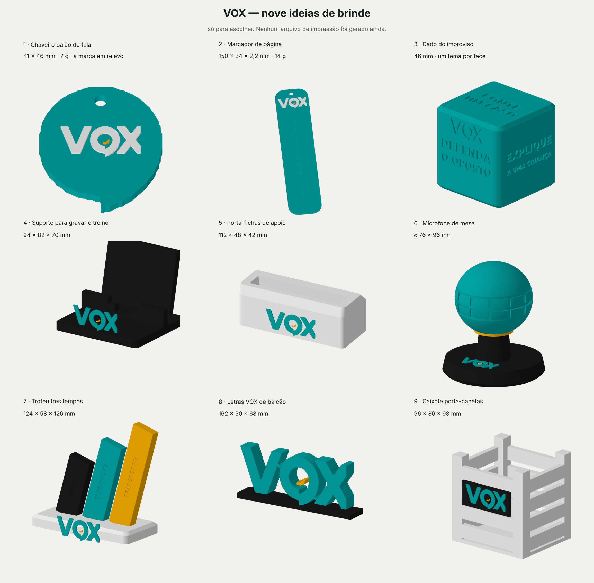

# Brindes VOX — nove ideias

**Estágio: só ideia.** Nenhum 3MF nem STL foi gerado. Os arquivos aqui desenham
as peças para escolher; depois da escolha é que viram arquivo de impressão.



| # | Peça | Medidas | Por quê |
|---|------|---------|---------|
| 1 | Chaveiro balão de fala | 41 × 46 mm · 7 g | a silhueta do O do logo, que já é um balão, com a marca em relevo |
| 2 | Marcador de página | 150 × 34 × 2,2 mm · 14 g | o mais barato por unidade; cabe em envelope |
| 3 | Dado do improviso | 46 mm | seis temas de treino, um por face — vira exercício de aula |
| 4 | Suporte para gravar o treino | 94 × 82 × 70 mm | retrato no vão, paisagem no rasgo da frente |
| 5 | Porta-fichas de apoio | 112 × 48 × 42 mm | segura as fichas de roteiro inclinadas, à vista |
| 6 | Microfone de mesa | ⌀ 76 × 96 mm | a peça de foto; cabeça em grade, base pesada |
| 7 | Troféu três tempos | 124 × 58 × 126 mm | as três barras do rodapé da marca, nas três cores, com FALE / COMUNIQUE / TRANSFORME |
| 8 | Letras VOX de balcão | 162 × 30 × 68 mm | recepção da unidade, não brinde |
| 9 | Caixote porta-canetas | 96 × 86 × 98 mm | o caixote da ambientação, em tamanho de mesa |

## Duas coisas a resolver antes de gerar arquivo

**O teal não existe no estoque.** A marca é `#03A6A5`. O estoque é laranja,
cinza, verde-mata, branco e preto — nenhum chega perto. Ou entra um filamento
teal na compra, ou a linha sai em branco/preto com o amarelo (`#F6AE02`) como
único acento. As duas saídas funcionam; é decisão de custo.

**O logo está em bitmap.** No PDF do rebranding o logo tem 283 px de largura.
O que está em `logo-vox.png` é a página renderizada a 900 dpi, ou seja,
interpolada — `marca_vox._traca` borra a máscara antes de traçar justamente para
o degrau do bitmap não virar serrilha na borda da letra. Serve para conceito.
Para arquivo de impressão vale pedir o vetor à franqueadora.

## Arquivos

- `marca_vox.py` — a marca como geometria: traçado do logo, cores, texto,
  utilidades de sólido. `marca()` devolve `(teal, amarelo, balao)` no mesmo
  sistema de coordenadas, com cache em `marca_vox.pkl`.
- `conceitos_vox.py` — os nove construtores e a lista `IDEIAS`.
- `ver_conceitos_vox.py` — monta a folha `ideias-brindes-vox.png`.

Nenhum deles grava 3MF ou STL, de propósito.

Para redesenhar:

```
python3 ver_conceitos_vox.py
```

Se mexer no traçado do logo, apague `marca_vox.pkl` antes — é cache.
